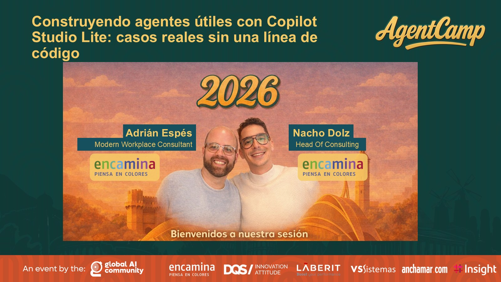

# Construyendo agentes útiles con Copilot Studio Lite

[Español](README.md) · [English](README.en.md)

Sesión presentada en el **AgentCamp Valencia 2026** (7 de marzo de 2026, ESIC Valencia) sobre cómo construir agentes realmente útiles con Copilot Studio Lite a partir de casos reales y sin escribir una línea de código.

## Contenido

- ¿Qué es un agente? Asistente vs. Agente
- Tecnologías y opciones para construir agentes
- Anatomía de un agente declarativo: Agent Builder vs. Copilot Studio
- ¿Cuándo me conviene uno u otro?
- Razonamiento lógico para construir agentes: qué evitar y cómo pensar
- ¿Cómo llego del input al output?
- Demo: agente de adopción de Microsoft 365 Copilot
- Tips y trucos para mejorar tu agente

## Material disponible

- Presentación de la sesión (PDF)
- Imagen de portada

## Ponentes

**Nacho Dolz**  
Head of Consulting

**Adrián Espés**  
Microsoft MVP · M365 Copilot

## Contacto

📧 aespes@adrianespes.com

🔗 LinkedIn: https://linkedin.com/in/adrianespes

---

© Adrián Espés. Material compartido con fines educativos y divulgativos.
