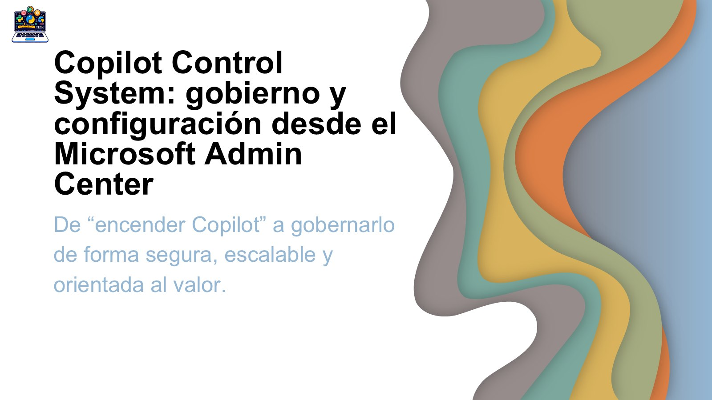

# Copilot Control System: gobierno y configuración desde el Microsoft Admin Center

[Español](README.md) · [English](README.en.md)

Sesión presentada en las **Tenerife Winter Sessions 2026** sobre cómo pasar de "encender Copilot" a gobernarlo de forma segura, escalable y orientada a resultados desde el Microsoft Admin Center.

## Contenido

- El día que el CIO preguntó: ¿quién controla realmente a Copilot?
- Copilot sin gobierno vs. Copilot con Copilot Control System
- ¿Qué controla realmente Copilot? Contexto, datos y puntos de entrada
- Configuración de puntos de acceso, protección y privacidad
- Copilot en Edge, búsqueda web y proveedores externos de IA
- ¿Quién puede hacer qué? Usuarios, roles, generación de imágenes y uso de agentes
- Riesgo y coste: pago por uso e informes de uso
- Despliegue seguro y escalable: fases y buenas prácticas

## Material disponible

- Presentación de la sesión (PDF)
- Imagen de portada

## Ponente

**Adrián Espés**  
Microsoft MVP · M365 Copilot

## Contacto

📧 aespes@adrianespes.com

🔗 LinkedIn: https://linkedin.com/in/adrianespes

---

© Adrián Espés. Material compartido con fines educativos y divulgativos.
