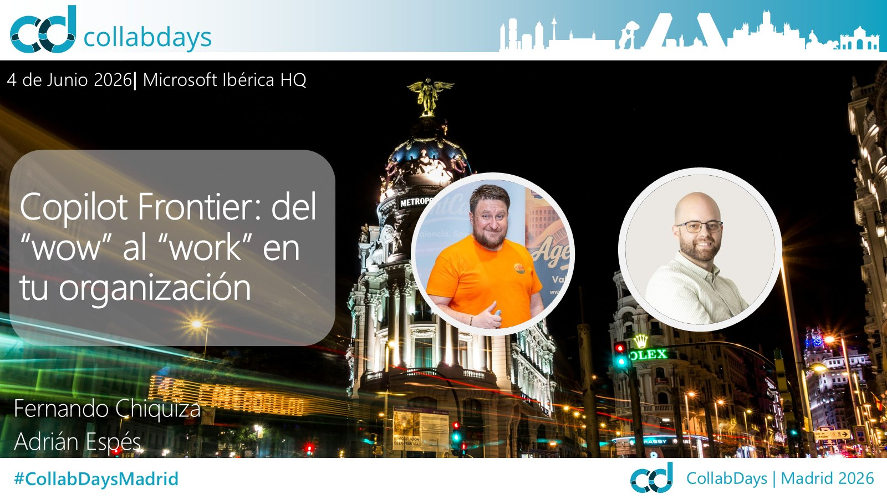

# Copilot Frontier: del "wow" al "work" en tu organización

[Español](README.md) · [English](README.en.md)

Sesión presentada en **CollabDays Madrid 2026** (4 de junio de 2026, Microsoft Ibérica HQ) sobre el programa Frontier de Microsoft 365 Copilot: qué es, cómo se habilita y, sobre todo, cómo convertir las funcionalidades en preview en trabajo real dentro de la organización.

## Contenido

- ¿Qué es Frontier? Empresas Frontier y acceso anticipado a capacidades de IA
- El ciclo de vida de una capacidad: del private preview a la disponibilidad general
- Graduados de Frontier: qué capacidades ya están en GA
- Del "wow" al "work": tres escenarios reales encadenando herramientas Frontier
- Copilot Cowork, Work IQ, skills y plugins
- ¿Qué tareas acelera de verdad? Investigar, sintetizar y analizar datos
- Backstage: prerrequisitos, habilitación mínima, políticas y modelo de rollout

## Material disponible

- Presentación de la sesión (PDF)
- Imagen de portada

## Ponentes

**Adrián Espés**  
Microsoft MVP · Modern Workplace Consultant

**Fernando Chiquiza**  
Microsoft MVP · Solution Specialist

## Contacto

📧 aespes@adrianespes.com

🔗 LinkedIn: https://linkedin.com/in/adrianespes

---

© Adrián Espés. Material compartido con fines educativos y divulgativos.
