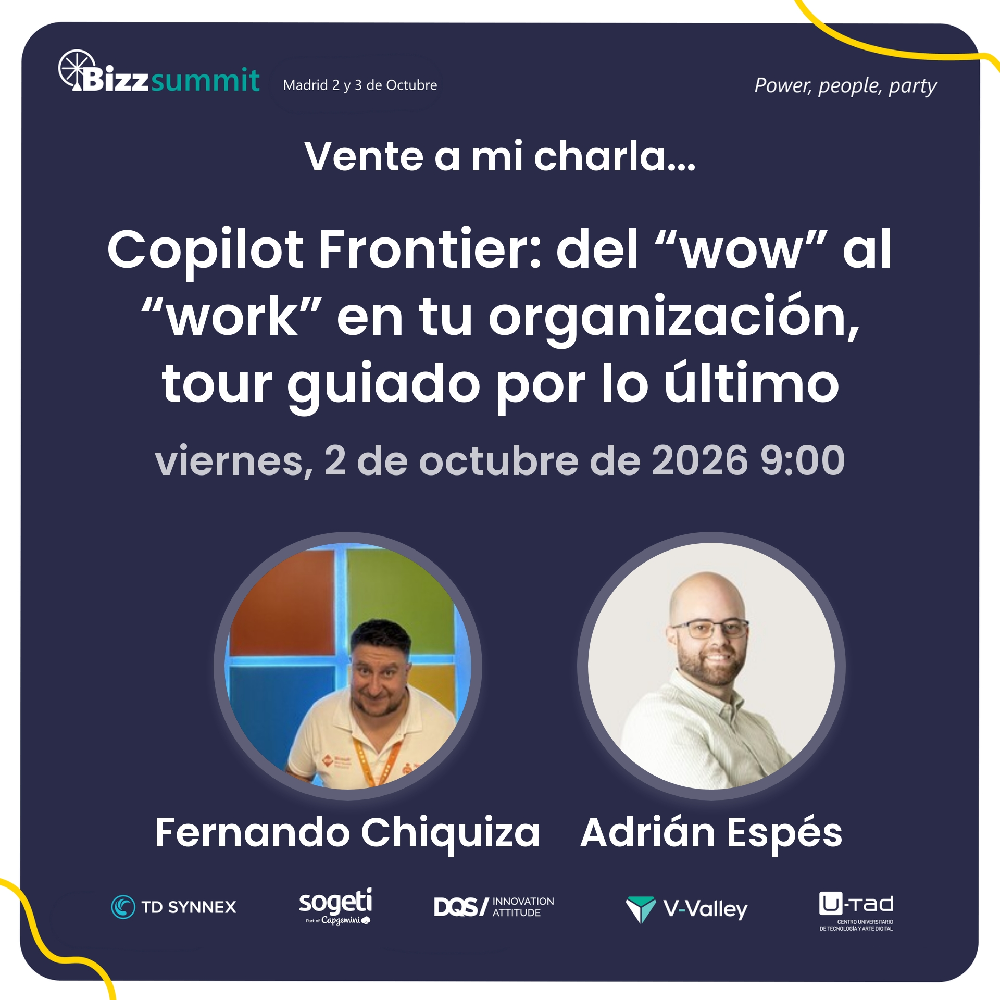

# Copilot Frontier: from "wow" to "work" in your organization, a guided tour of the latest

[Spanish](README.md) · [English](README.en.md)

Session delivered at **BizzSummit 2026** (Madrid, October 2, 2026) together with Fernando Chiquiza. The "wow" effect is impressive in a demo, but what stays in an organization is the "work": repeatable processes, real execution, and results people actually use. A guided tour of the latest in Microsoft 365 Copilot with three chained demos built on a single case.

## Content

- The thesis: from the demo "wow" to everyday "work"
- A single storyline case (synthetic data): launching an internal adoption initiative
- Block 01 · Skills in Agent Builder: teaching Copilot a procedure, not just a request
- Block 02 · Cowork Browser Use: Copilot acting on a website where you are already signed in
- Block 03 · App Builder: turning the output into something people can use
- Deployment requirements, preview limitations, and a plan B for each scenario

## Available material

- Session presentation (PDF)
- Cover image

## Speakers

**Adrián Espés** 
Microsoft MVP · Modern Workplace Consultant

**Fernando Chiquiza** 
Microsoft MVP · Solution Specialist

## Contact

📧 aespes@adrianespes.com

🔗 LinkedIn: https://linkedin.com/in/adrianespes

---

© Adrián Espés. Material shared for educational and informational purposes.
