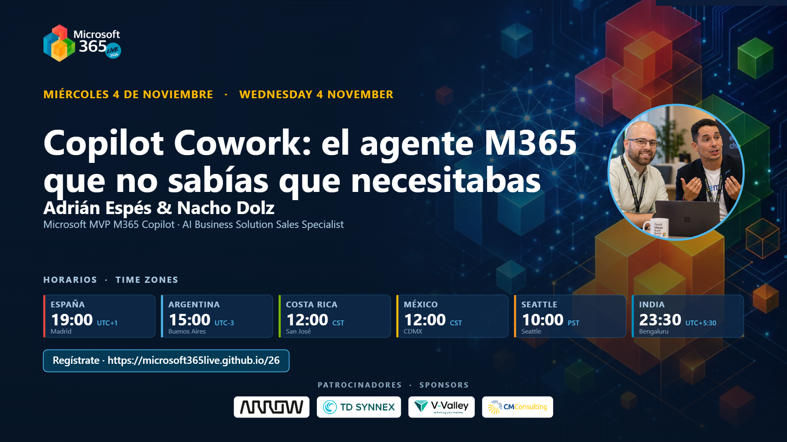

# Cowork: the AI kitchen

[Spanish](README.md) · [English](README.en.md)

Session delivered at **Microsoft 365 Live 2026** (Wednesday, November 4, 2026, 7:00 PM CET) together with Nacho Dolz, under the title *"Copilot Cowork: el agente M365 que no sabías que necesitabas"*. Copilot Cowork explained as a professional kitchen: what it is, when to use it, and what it costs. Seven blocks to move from line cook to head chef, with live demos and an app built by Cowork itself.

## Content

- Block 01 · What Cowork and WorkIQ are: the pantry that thinks and the chef that actually has hands
- Block 02 · Cowork Skills: the recipe book that packages your expertise in a `SKILL.md`
- Block 03 · Today's work vs. tomorrow's work: shifting your role to head chef
- Block 04 · What to use and when: Copilot Chat, Copilot in the app, Copilot Studio, Cowork, and Scout
- Block 05 · The 4 pillars of adoption: people, processes, technology, and governance
- Block 06 · The 4 pillars of cost: Copilot Credits, Pay-As-You-Go, and the Pre-Purchase Plan
- Block 07 · Use cases and demos: email, event design, data analysis, Browser Use in Edge, and the *AI Kitchen Live* app

## Available material

- Session presentation (PDF)
- Official session cover from M365 Live 2026

## Speakers

**Adrián Espés** 
Microsoft MVP · Modern Workplace Consultant · ENCAMINA

**Nacho Dolz** 
Technical Solutions Lead & Sales Specialist · ENCAMINA

## Contact

📧 aespes@adrianespes.com

🔗 LinkedIn: https://linkedin.com/in/adrianespes

---

© Adrián Espés. Material shared for educational and informational purposes.
