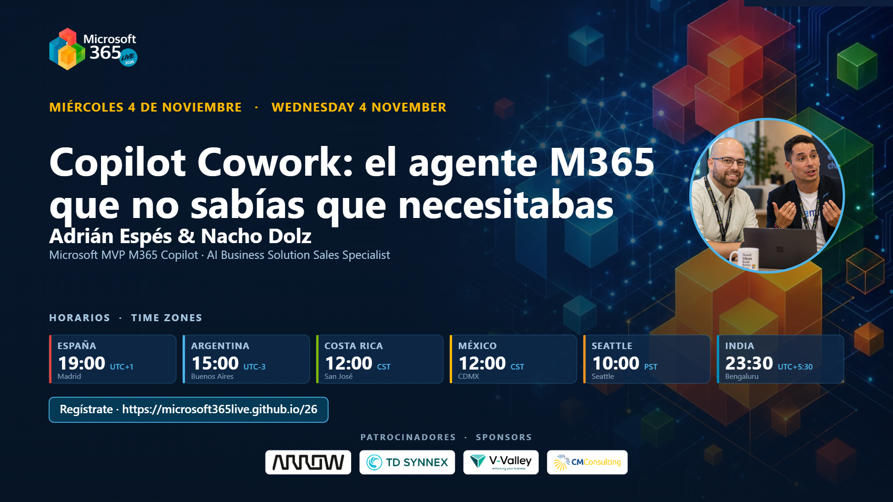

# Cowork: la cocina de la IA

[Español](README.md) · [English](README.en.md)

Sesión presentada en **Microsoft 365 Live 2026** (miércoles 4 de noviembre de 2026, 19:00 CET) junto a Nacho Dolz, bajo el título *«Copilot Cowork: el agente M365 que no sabías que necesitabas»*. Copilot Cowork explicado como una cocina profesional: qué es, cuándo usarlo y qué cuesta. Siete bloques para pasar de cocinero a jefe de cocina, con demos en directo y una app construida por el propio Cowork.

## Contenido

- Bloque 01 · Qué son Cowork y WorkIQ: la despensa que piensa y el cocinero que sí tiene manos
- Bloque 02 · Skills de Cowork: el recetario que empaqueta tu expertise en un `SKILL.md`
- Bloque 03 · Trabajo de hoy vs. trabajo del futuro: el cambio de rol a jefe de cocina
- Bloque 04 · Qué usar y cuándo: Copilot Chat, Copilot en la app, Copilot Studio, Cowork y Scout
- Bloque 05 · Los 4 pilares de la adopción: personas, procesos, tecnología y gobernanza
- Bloque 06 · Los 4 pilares del coste: Copilot Credits, Pay-As-You-Go y Pre-Purchase Plan
- Bloque 07 · Casos de uso y demos: email, diseño de eventos, análisis de datos, Browser Use en Edge y la app *AI Kitchen Live*

## Material disponible

- Presentación de la sesión (PDF)
- Portada oficial de la sesión en M365 Live 2026

## Ponentes

**Adrián Espés**  
Microsoft MVP · Modern Workplace Consultant · ENCAMINA

**Nacho Dolz**  
Technical Solutions Lead & Sales Specialist · ENCAMINA

## Contacto

📧 aespes@adrianespes.com

🔗 LinkedIn: https://linkedin.com/in/adrianespes

---

© Adrián Espés. Material compartido con fines educativos y divulgativos.
