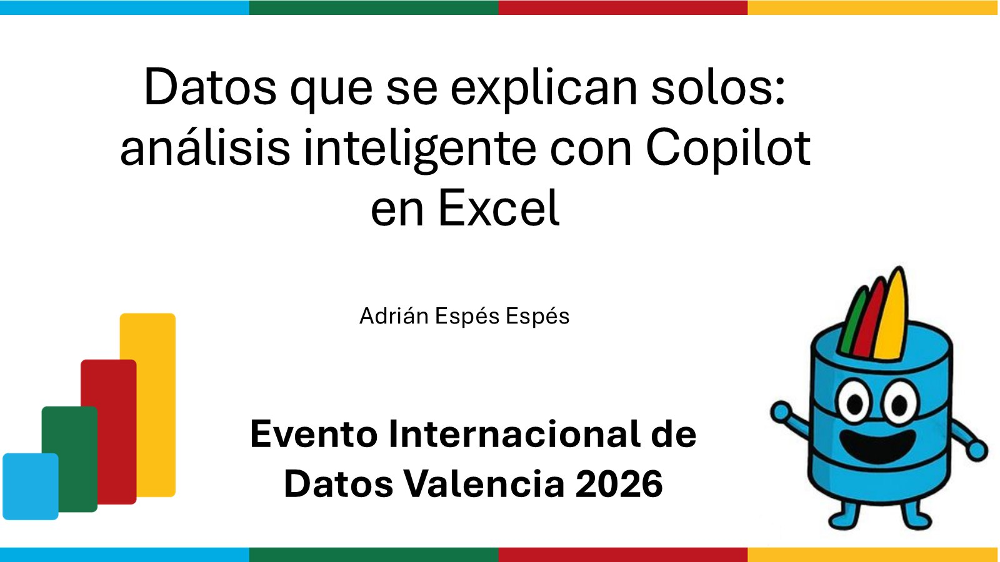

# Datos que se explican solos: análisis inteligente con Copilot en Excel

[Español](README.md) · [English](README.en.md)

Sesión presentada en el **Evento Internacional de Datos Valencia 2026** sobre cómo el modo agente de Copilot convierte Excel en un analista que comprende, razona y actúa sobre tus datos.

## Contenido

- El problema del análisis de datos tradicional
- Copilot en "modo agente": el nuevo paradigma
- Capacidades de Copilot en Excel: análisis con lenguaje natural
- De herramienta a colaborador: del dato en bruto al insight
- Demo en vivo: "Editar con Copilot" con prompts y con script
- Casos de uso prácticos en ventas y finanzas
- Cómo sacarle el máximo partido: datos bien estructurados y buenas prácticas

## Material disponible

- Presentación de la sesión (PDF)
- Imagen de portada

## Ponente

**Adrián Espés**  
Microsoft MVP · M365 Copilot

## Contacto

📧 aespes@adrianespes.com

🔗 LinkedIn: https://linkedin.com/in/adrianespes

---

© Adrián Espés. Material compartido con fines educativos y divulgativos.
