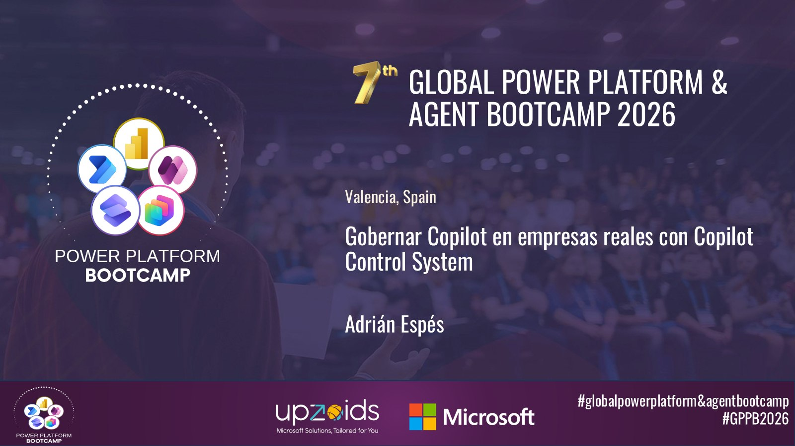

# Governing Copilot in real companies with Copilot Control System

[Spanish](README.md) · [English](README.en.md)

Session delivered at the **Global Power Platform & Agent Bootcamp 2026** (Valencia) about turning Copilot into a stable, useful, and reliable asset through a clear system of usage, control, and continuous improvement.

## Content

- The real challenge: why Copilot needs governance
- Risks introduced by Copilot: data, AI, and compliance
- What is Copilot Control System (CCS)? The official governance framework
- Security & governance: data protection, AI security, compliance, and auditing
- Management controls: licensing, costs, lifecycle, connectors, and permissions
- Measurement & reporting: adoption and productivity metrics
- A control for every risk: mitigation matrix
- Strategic decisions: web search, prebuilt vs. custom agents, and AI providers
- Copilot operating model: roles and processes
- Key metrics and proving impact

## Available material

- Session presentation (PDF)
- Cover image

## Speaker

**Adrián Espés** 
Microsoft MVP · M365 Copilot

## Contact

📧 aespes@adrianespes.com

🔗 LinkedIn: https://linkedin.com/in/adrianespes

---

© Adrián Espés. Material shared for educational and informational purposes.
