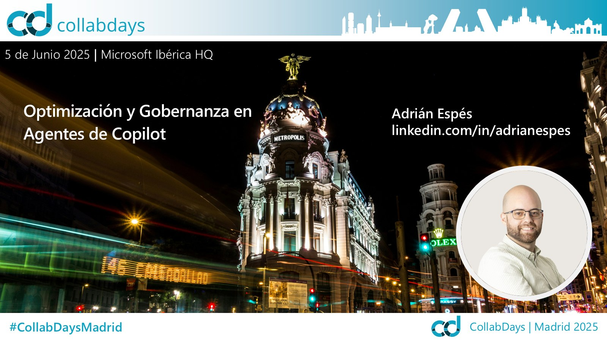

# Optimization and Governance for Copilot Agents

[Spanish](README.md) · [English](README.en.md)

Session delivered at **CollabDays Madrid 2025** (June 5, 2025, Microsoft Iberia HQ) about designing effective declarative agents and, above all, how to govern and control them across the organization.

## Content

- Introduction to Copilot declarative agents
- Basic anatomy of an agent and the tools to build one
- Designing effective agents: goal, instructions, knowledge, tone, and constraints
- Knowledge sources: web content, SharePoint, and Copilot connectors
- Governance and control: M365 Admin Center, Copilot Control System, and usage reports
- Permissions, sharing, and metered consumption (pay-as-you-go)
- Agent adoption and governance lifecycle

## Available material

- Session presentation (PDF)
- Cover image

## Speaker

**Adrián Espés** 
Microsoft MVP · M365 Copilot

## Contact

📧 aespes@adrianespes.com

🔗 LinkedIn: https://linkedin.com/in/adrianespes

---

© Adrián Espés. Material shared for educational and informational purposes.
