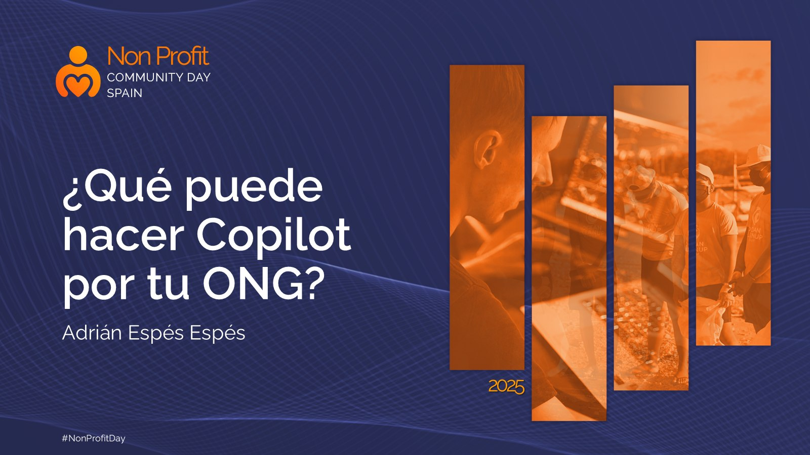

# What can Copilot do for your NGO?

[Spanish](README.md) · [English](README.en.md)

A session for non-profit organizations about how Microsoft Copilot helps optimize resources and increase social impact, freeing up time for what really matters.

## Content

- What is Microsoft Copilot?
- Copilot as AI to boost social impact
- Key benefits for your NGO
- Use case: managing and communicating social project results
- Writing the monthly report from meeting notes and activity summaries
- Analyzing and visualizing donation and impact data
- Preparing the presentation for the board and donors
- Key considerations for responsible use and Copilot's limitations

## Available material

- Session presentation (PDF)
- Cover image

## Speaker

**Adrián Espés** 
Microsoft MVP · M365 Copilot

## Contact

📧 aespes@adrianespes.com

🔗 LinkedIn: https://linkedin.com/in/adrianespes

---

© Adrián Espés. Material shared for educational and informational purposes.
