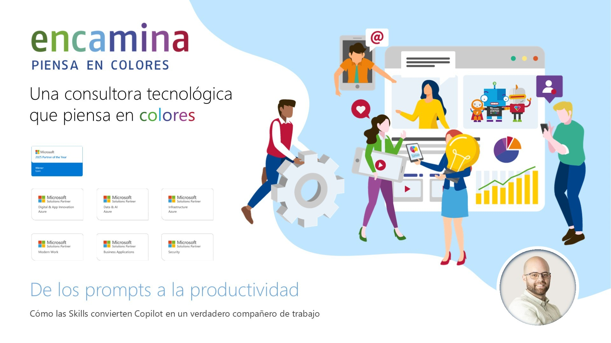
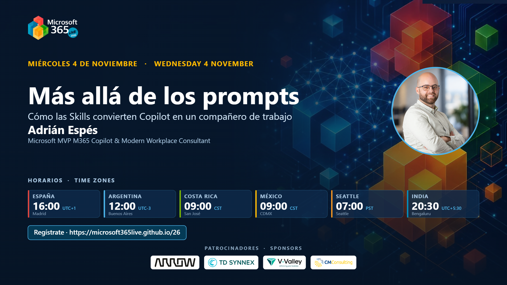

# From prompts to productivity: how Skills turn Copilot into a real coworker

[Spanish](README.md) · [English](README.en.md)

Session delivered at **Microsoft 365 Live 2026** (Wednesday, November 4, 2026, 4:00 PM CET), under the title *"Más allá de los prompts: cómo las Skills convierten Copilot en un compañero de trabajo"*. The M365 Live edition of the Skills talk: the 40-line prompt you paste every Monday becomes a reusable capability. Five chained demos with fictional data to walk the path from prompt to Skill.

> There is also a [Cloud Champion 2026 edition](../skills-copilot-companero-de-trabajo/) of this same session.

## Content

- The starting point: the long prompt that repeats, is inconsistent, and does not scale
- Prompt, agent, and Skill: the what, the who, and the how
- Anatomy of a Skill: folder, `SKILL.md`, YAML frontmatter, references, and templates
- Where Skills live today: PowerPoint, Excel, Cowork, and Agent Builder
- Demo 01 · Copilot Chat: the "before", the prompt that explains everything
- Demo 02 · PowerPoint web + OneDrive: your first personal Skill
- Demo 03 · Agents and Skills: creating a Skill just by talking
- Demo 04 · Agent Builder: one agent with several Skills packaged as ZIP
- Demo 05 · Cowork: delegating the work with your own method
- Use cases to start on Monday and governance best practices

## Available material

- Session presentation (PDF)
- Cover image
- Official session announcement at M365 Live 2026
- Demo kit (`kit-demos/`): fictional briefs, sample Skills, and a demo guide

## Speaker

**Adrián Espés** 
Microsoft MVP · Modern Workplace Consultant · ENCAMINA

## Contact

📧 aespes@adrianespes.com

🔗 LinkedIn: https://linkedin.com/in/adrianespes

---

© Adrián Espés. Material shared for educational and informational purposes.
