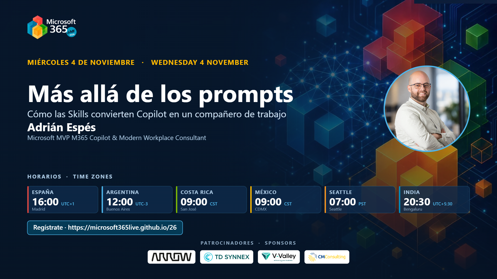

# De los prompts a la productividad: cómo las Skills convierten Copilot en un verdadero compañero de trabajo

[Español](README.md) · [English](README.en.md)

Sesión presentada en **Microsoft 365 Live 2026** (miércoles 4 de noviembre de 2026, 16:00 CET), bajo el título *«Más allá de los prompts: cómo las Skills convierten Copilot en un compañero de trabajo»*. Edición M365 Live de la charla sobre Skills: el prompt de 40 líneas que pegas cada lunes se convierte en una capacidad reutilizable. Cinco demos encadenadas con datos ficticios para recorrer el camino del prompt a la Skill.

> Existe también la [edición Cloud Champion 2026](../skills-copilot-companero-de-trabajo/) de esta misma sesión.

## Contenido

- El punto de partida: el prompt largo que se repite, no es consistente y no escala
- Prompt, agente y Skill: el qué, el quién y el cómo
- Anatomía de una Skill: carpeta, `SKILL.md`, frontmatter YAML, referencias y plantillas
- Dónde viven hoy las Skills: PowerPoint, Excel, Cowork y Agent Builder
- Demo 01 · Copilot Chat: el antes, el prompt que lo explica todo
- Demo 02 · PowerPoint web + OneDrive: tu primera Skill personal
- Demo 03 · Agents and Skills: crear una Skill solo hablando
- Demo 04 · Agent Builder: un agente con varias Skills empaquetadas en ZIP
- Demo 05 · Cowork: delegar el trabajo con tu método
- Casos de uso para empezar el lunes y buenas prácticas de gobernanza

## Material disponible

- Presentación de la sesión (PDF)
- Portada oficial de la sesión en M365 Live 2026
- Kit de demos (`kit-demos/`): briefs ficticios, Skills de ejemplo y guía de demos

## Ponente

**Adrián Espés**  
Microsoft MVP · Modern Workplace Consultant · ENCAMINA

## Contacto

📧 aespes@adrianespes.com

🔗 LinkedIn: https://linkedin.com/in/adrianespes

---

© Adrián Espés. Material compartido con fines educativos y divulgativos.
